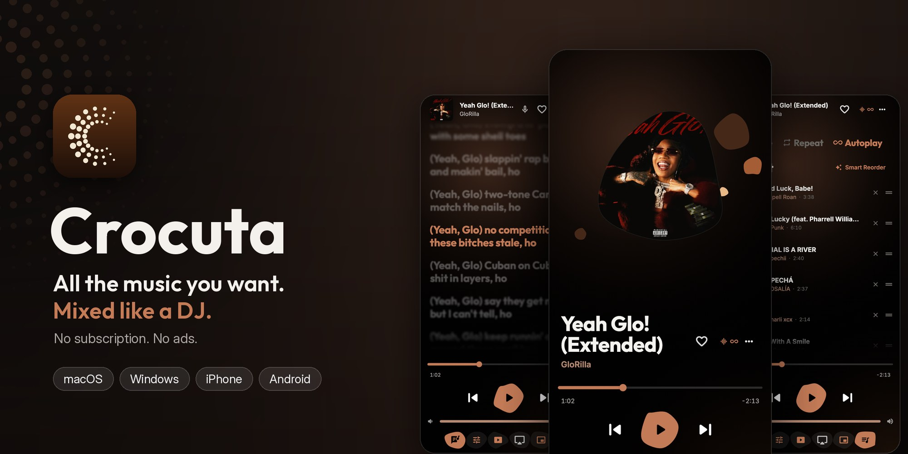
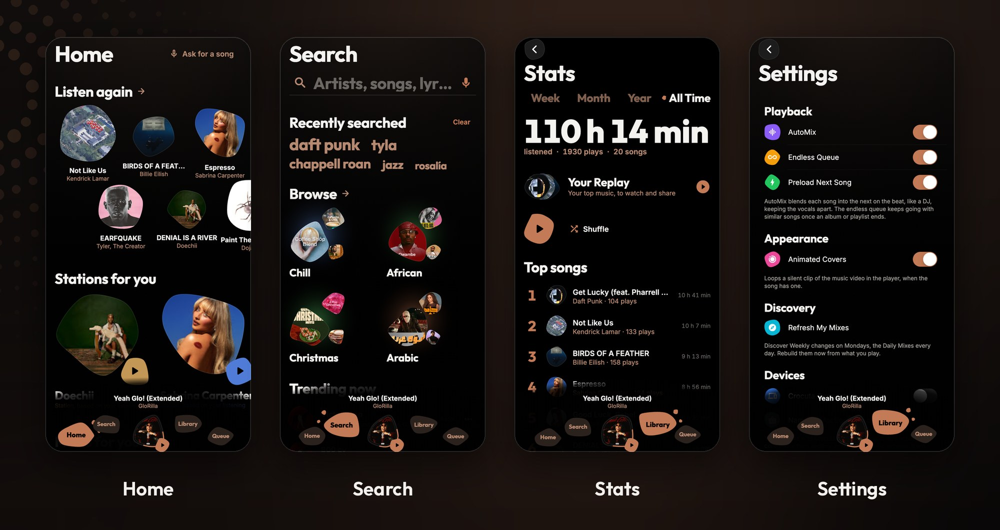
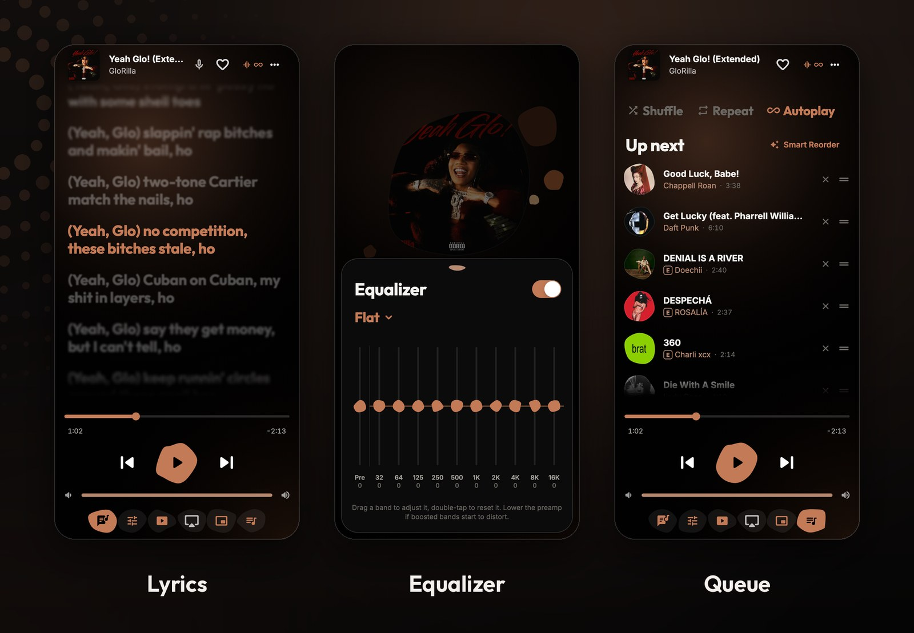
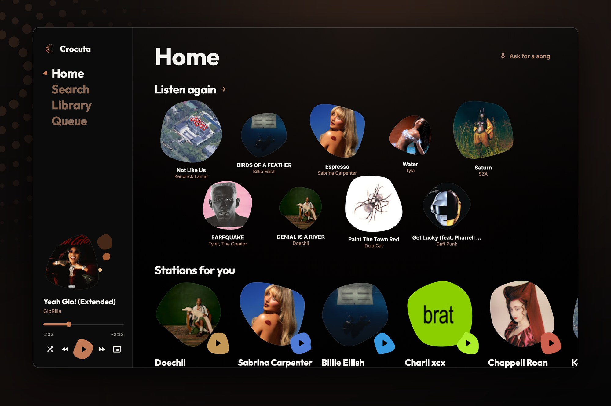

  

<h3 align="center">The music player that mixes like a DJ, sings along with you, and follows you from one device to the next.</h3>

  
  
  
  
   
  
  
  
  

  <a href="https://github.com/IsThisDemi/Crocuta/releases/latest"><b>⬇︎ Download</b></a> ·
  <a href="docs/INSTALL.md"><b>Install guide</b></a> ·
  <a href="docs/SYNC.md"><b>Sync your devices</b></a> ·
  <a href="docs/DEVELOPMENT.md"><b>Build it yourself</b></a>

 

**All of YouTube Music, in a player that actually cares how it sounds.** No
subscription, no ads, no account. Songs flow into each other on the beat,
the vocals step aside when you want to sing, and your library is waiting on
every device you own.

## ✦ Why Crocuta

<table>
<tr>
<td width="33%" valign="top">

### 🎛️ AutoMix
Every song flows into the next **on the beat**, like on a DJ deck. Crocuta
reads the tempo, the key and the phrases, and **splits vocals from the
instrumental**, so two voices never clash. *Smart Reorder* lines up your
queue for transitions that just flow.

</td>
<td width="33%" valign="top">

### 🎤 Karaoke
Tap the mic and **the vocals fade out**, leaving the original backing
track. Lyrics are synced line by line and saved for offline listening.

</td>
<td width="33%" valign="top">

### 📡 Crocuta Connect
Your devices **find each other** on the same Wi-Fi: control your Mac from
your phone, or **hand the music over** from one to the other without
missing a beat.

</td>
</tr>
<tr>
<td valign="top">

### 🧭 Made for You
**Discover Weekly** every Monday, **Daily Mixes** every day, and smart
playlists (*On Repeat*, *Late Night*, *Forgotten*) built from what you
actually listen to.

</td>
<td valign="top">

### 🎬 Living covers
When a song has a music video, its cover **comes alive** as a silent loop.
One tap plays the **full-screen video**, with high-quality audio.

</td>
<td valign="top">

### 🗣️ Siri, widgets, CarPlay
"Play my favorites on Crocuta." Widgets on your iPhone Home Screen, on the
Lock Screen, on your Mac desktop and, since iOS 26, **in CarPlay**.

</td>
</tr>
</table>

  

## ✦ A look that moves with the music

  

Crocuta is dressed in **Macchia**: a black canvas where covers and controls
are living spots, and the only color on screen is the **song's**. It tints
the buttons, the glow and the app mark; during a mix, the two songs'
colors pulse into each other. On the phone, the player and the tabs share
one dock: the cover sits in the middle, the sections orbit around it, and
you slide a finger from one to the next.

## ✦ Everything you'd expect, and then some

🎧 **Listening**
- The whole YouTube Music catalog, real songs ahead of videos, with
  suggestions as you type
- The best quality available (up to 256 kbps AAC / 160 kbps Opus), streamed
  or **downloaded for offline**
- An **endless queue** that keeps going with similar songs, and *Start
  Radio* from any track
- Close the app, reopen it: same queue, same song, **same second**

🎚️ **Sound and lyrics**
- **Synced lyrics** that scroll on their own; tap a line to jump to it
- A **10-band equalizer** with presets and a live-drawn curve
- Vocal separation runs **on your device**: nothing is uploaded, ever

🧭 **Discover**
- Top Picks, new releases from the artists you follow, stations for you
- **Stats** by week, month, year and all time: your own *Replay*, ready to
  share

📚 **Your library**
- Liked songs, playlists, albums, artists and downloads, all searchable
- **Import from Spotify** in a couple of taps: likes, playlists, albums
  and followed artists
- **Import from Apple Music**: your library and playlists, read from the
  Music app on Mac and iPhone or from an exported library file
- **Synced across your devices** through *your own* Google Drive: no
  accounts, no third-party servers ([how](docs/SYNC.md))

## ✦ Everywhere you listen

  

| | |
|---|---|
| 🍎 **Mac** | Media keys, Control Center, a desktop widget, keyboard shortcuts, and a full-screen player |
| 📱 **iPhone** | Lock Screen and Dynamic Island, Home Screen, Lock Screen and **CarPlay** widgets, **Siri** and Shortcuts |
| 🤖 **Android** | The same app, the same library, the same dock |
| 🖥️ **Windows** | The same app, as an installer or a portable zip |
| 🔗 **Across them** | **Connect** to control one device from another, **sync** for your library and listening history |

## ✦ Get it

Grab the latest build from the
**[Releases page](https://github.com/IsThisDemi/Crocuta/releases/latest)**:

| | File |
|---|---|
| 🍎 **Mac** (Apple Silicon) | `Crocuta-…-apple-silicon.dmg` |
| 📱 **iPhone** | `Crocuta-…-iphone.ipa`, installed with AltStore and a free Apple ID |
| 🤖 **Android** | `Crocuta-…-android-arm64.apk` |
| 🖥️ **Windows** | `Crocuta-…-windows-setup.exe` or the portable zip |

None of these are in an app store, so each platform asks for one extra
step the first time: the **[install guide](docs/INSTALL.md)** walks you
through it. Prefer to build it yourself? See
**[DEVELOPMENT.md](docs/DEVELOPMENT.md)**.

---

Crocuta is an independent, non-commercial project, not affiliated with
or endorsed by YouTube, Google, Spotify or Apple. It plays YouTube Music
without the official app, which YouTube's terms of service don't allow:
use it for your own listening, and don't publish it on an app store.
YouTube can change its systems at any time, so playback may need an update
now and then. The code is released under the [MIT license](LICENSE); fonts
and bundled libraries keep their own licenses.

  
   
  Handmade, for better listening.

